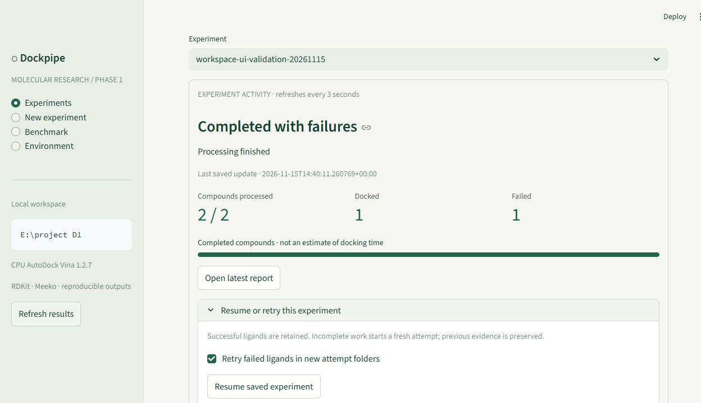

# Dockpipe — Phase 1 molecular docking

A working local scientific engine and researcher UI for **real CPU AutoDock Vina 1.2.7** docking. Python, RDKit, Meeko, Gemmi and Biopython prepare and validate structures; the Vina subprocess computes the poses and scores. Results are never simulated.

The active project is `E:\project D1`. The Python environment is `.venv`, the official Vina executable is `tools\vina.exe`, and new experiments are stored under `results\<experiment_id>`.

## Open the frontend

Double-click **`start-ui.cmd`**, then open **http://127.0.0.1:8501**. Or use PowerShell:

```powershell
Set-Location -LiteralPath 'E:\project D1'
$env:VINA_EXECUTABLE = 'E:\project D1\tools\vina.exe'
& .\.venv\Scripts\dockpipe.exe ui
```

The UI provides:

- **Experiments:** searchable saved runs, status filters, persistent stage/progress counts, recovery controls, real rankings, failure records, interactive 3D ligand poses with receptor backbone/crystal overlay, per-pose scores, manifests, validation and downloads.
- **New experiment:** PDB/mmCIF upload, SDF/CSV/SMILES ligand input, chain and reference selection, explicit water/cofactor handling, reference or manual grid, CPU budget, seed, exhaustiveness and pose count.
- **Benchmark:** run genuine 1IEP/imatinib redocking with a measured RMSD outcome.
- **Environment:** inspect actual installed package versions and the executable.

Jobs run as background local CLI processes. Page reruns do not stop them. Progress and logs remain visible; resume uses the original configuration and verifies completed artifacts. A single UI server accepts one UI calculation at a time. Manually launching additional independent CLI jobs can exceed the combined machine budget; coordinate those yourself. The server binds only to `127.0.0.1`; it is not an authenticated public web service.

## Verified scientific result

`results/1iep-local-validation/report.md` records a complete run from this folder:

| Measurement | Observed value |
|---|---:|
| Protein/reference | PDB 1IEP, chain A, STI 201 (imatinib) |
| Best computed Vina score | −12.770 kcal/mol |
| Top-pose symmetry-aware heavy-atom RMSD | 0.893205 Å |
| Redocking criterion | top-scoring pose RMSD ≤ 2 Å |
| Outcome | passed |
| Exhaustiveness / seed / CPU threads | 32 / 20261113 / 2 |
| Exported poses | 9 |

These are measured outputs, not constants used by the pipeline. A second complete run after moving the workspace produced identical pose coordinates and scores. The validation reference uses CCD atom names and bond orders with original experimental coordinates. Docking starts from a newly embedded and optimized ligand conformer, not the crystallographic conformation.

The setup follows the [official Vina basic-docking tutorial](https://autodock-vina.readthedocs.io/en/stable/docking_basic.html), including its center `(15.190, 53.903, 16.917)` and `20 × 20 × 20 Å` box. This implementation prepares the original RCSB chain A with strict Meeko matching. It explicitly removes waters and chloride residues A:1, A:2, A:4 and A:5, preserves STI coordinates, and excludes unselected chain B. Source URLs and SHA-256 hashes are in `data/benchmarks/1iep/sources.json`. Official tutorial input files are pinned to commit `bb64e5e26b520569a86360d69248069b5e665b3f` for comparison/provenance.

## CLI commands on this machine

```powershell
Set-Location -LiteralPath 'E:\project D1'
$env:VINA_EXECUTABLE = 'E:\project D1\tools\vina.exe'
$env:PATH = 'E:\project D1\tools;' + $env:PATH

# Actual dependency, import, executable, and version checks
& .\.venv\Scripts\dockpipe.exe check

# Multi-ligand example: includes one deliberately invalid SMILES to demonstrate failure isolation
& .\.venv\Scripts\dockpipe.exe run --config config/default.yaml

# Resume unchanged input/configuration; successful results are retained
& .\.venv\Scripts\dockpipe.exe run --config config/default.yaml --resume

# Inspect saved state without starting calculations or requiring the UI
& .\.venv\Scripts\dockpipe.exe status --job results/1iep-local-validation

# Retry failed ligands in fresh attempt directories
& .\.venv\Scripts\dockpipe.exe run --config config/default.yaml --resume --retry-failed

# Full benchmark; choose a new --job value for a new calculation
& .\.venv\Scripts\dockpipe.exe benchmark --id 1iep --job my-1iep-benchmark

# Rebuild human-readable exports from saved results
& .\.venv\Scripts\dockpipe.exe report --job results/1iep-local-validation

# Fetch a public structure without replacing an existing file
& .\.venv\Scripts\dockpipe.exe fetch --id 1iep --output data/proteins

# Standalone preparation
& .\.venv\Scripts\dockpipe.exe prepare-receptor --input data/benchmarks/1iep/1iep.pdb --chains A --reference A:201:STI --remove-residues A:1:CL A:2:CL A:4:CL A:5:CL --output results/prepared-receptor
& .\.venv\Scripts\dockpipe.exe prepare-ligands --input data/ligands/example.csv --output results/prepared-ligands

# Full tests including recomputation of reference RMSD from real benchmark artifacts
$env:DOCKPIPE_BENCHMARK_JOB = 'E:\project D1\results\1iep-local-validation'
& .\.venv\Scripts\python.exe -m pytest -q
```

Exit codes: `0` successful command/benchmark; `1` setup or execution error; `2` failed ligand(s) or environment not ready; `3` completed benchmark that failed the RMSD criterion. A failed benchmark is preserved and reported.

## Clean installation

For a fresh **Windows** clone, run from the repository root:

```powershell
py -3.12 -m venv .venv
& .\.venv\Scripts\python.exe -m pip install -r requirements-windows.lock.txt
& .\.venv\Scripts\python.exe scripts/install_vina.py
.\start-ui.cmd
```

The checked-in `evidence/1iep/` directory contains observed validation, real poses, the Vina log, protocol configuration, rankings, and test output. These are historical evidence; live runs always execute the scientific software.

### Linux / WSL

Fresh-checkout integration tests pass on **Ubuntu 24.04 and Windows Server 2025 with Python 3.12.10**, in addition to the local Windows 11 verification. WSL is not installed on the development machine and has not been tested directly. No GPU is used.

Full Linux 1IEP redocking also passed: top-pose RMSD **0.968343 Å**, score **−12.749 kcal/mol**. These differ slightly from the Windows calculation; both meet the 2 Å criterion. Raw numerical evidence and CI provenance are in `evidence/cross-platform/`.

```bash
cd /path/to/drug-discovery
python3.12 -m venv .venv
source .venv/bin/activate
python -m pip install -e '.[test,ui]'
python scripts/install_vina.py
export PATH="$PWD/tools:$PATH"
export VINA_EXECUTABLE="$PWD/tools/vina"
dockpipe check
dockpipe benchmark --id 1iep --job initial-validation
dockpipe ui
```

Alternatively, `conda env create -f environment.yml` creates a Python environment; then install Vina with the same script. Core and UI direct dependencies are pinned in `pyproject.toml`; `requirements-windows.lock.txt` records the full verified Windows dependency set. Install that file in a new Windows venv for the exact verified package versions. It is not a conda lock or a verified Linux transitive lock. The installer records the executable SHA-256; its Windows download is checked against the build used here. Other platforms record the downloaded hash without claiming a publisher-signed checksum.

## Automated verification

The optional [Scientific checks workflow](https://github.com/abhishekbruno/drug-discovery-phase1/actions/workflows/scientific-checks.yml) installs the pinned tools into fresh virtual environments on Windows and Ubuntu. It runs the unit, frontend and real Vina integration tests, then performs full 1IEP redocking on Linux for relevant pushes. Pull requests run the test matrix; the full benchmark can also be started with **Run workflow**.

Each run preserves environment versions and JUnit results for 14 days. The full benchmark preserves raw poses, scores, preparation logs, configuration and RMSD validation for 30 days, including failed runs. Dependency or scientific failures fail the workflow. CI uses CPU tools and is not required to run the app locally.

## Configuration and inputs

Use `config/default.yaml` as a template. Paths in YAML or JSON configuration resolve relative to the configuration file. Use unique portable identifiers (letters, numbers, `_`, `-`, `.`; no traversal, reserved Windows names or case-colliding compound IDs).

- CSV columns: `compound_id,smiles`.
- SMILES: one `SMILES compound_id` per line; `.smi`, `.smiles`, or `.txt`.
- SDF: each record's title is its compound ID; missing titles receive a generated ID. Invalid molecular records remain failures. Invalid/duplicate identifiers invalidate the input library to avoid ambiguous result association.
- Protein: single-model PDB or mmCIF; explicit chains required. The Meeko PDB bridge currently requires one-character chain IDs. Select a single model externally for ensembles.
- Residue IDs: `chain:number:name`, e.g. `A:201:STI`; insertion codes are appended to the sequence number. Blank chain IDs are represented by an empty prefix.
- `grid.mode: reference` derives the bounding-box center and pads all sides. `manual` requires all center and size components. Box sides are limited to 50 Šand volume to 64000 ų.
- `workers * cpu` cannot exceed the lesser of 8 or available logical CPUs. Default batch operation is sequential.
- A nonzero explicit seed is recorded. Vina's scoring function is fixed to `vina` in Phase 1; incompatible scoring functions cannot enter a ranking.
- `protein.residue_templates` allows explicit Meeko residue-state overrides, e.g. `{"A:246": "HID"}` after scientific review. Default Meeko templates are used otherwise. No automatic pKa calculation is implied.

## Output and resume contract

Each experiment preserves original input copies, their hashes, resolved configuration, software/executable information, grid, strict receptor preparation log and inventory, preparation manifests, and per-ligand attempt directories. Each completed calculation contains the real Vina log, exact argument vector, PDBQT poses, chemically reconstructed SDF poses and parsed energies. `report.json`, `report.md`, `ranking.csv`, `poses.csv`, and `status.csv` are generated automatically.

Existing experiments are never silently replaced. Resume checks configuration, input hashes, software versions and executable hash, plus completed artifact inventory and metadata. Failed attempts remain and retries create new numbered directories. OS locks release when a process dies; interrupted work can be resumed. Fatal receptor preparation failures have `experiment.json` status and detailed preparation logs; no ranking is produced until receptor preparation succeeds.

Retries checkpoint the previous completed attempt before replacing its status. If interrupted, resume starts a fresh attempt while retaining and verifying the older evidence; already successful ligands are reused. Parallel workers serialize experiment-manifest updates. A handled interruption records `interrupted`; an abrupt process termination may leave `running`, which can still be resumed after the process lock is released.

New runs save the processing stage and counts of completed, successful and failed compounds. Counts describe compounds handled in the current invocation (including verified cached results on resume), not estimated docking time. The selected experiment's UI activity panel refreshes every three seconds; use **Open latest report** to load a newly written report. A saved running state does not prove that a process is still alive. Older experiments show their existing state and reports without inventing missing counts. Unreadable metadata/report errors are isolated so other experiments remain accessible. `dockpipe status --job <path-or-id>` provides the same read-only summary and exits 1 for missing experiments or unreadable metadata.

Resolved experiment paths are absolute. **Do not relocate an active experiment and expect resume to match its identity.** The original pre-move calculation is retained as historical evidence; the independently rerun `1iep-local-validation` uses E-drive paths. For another relocation, preserve old evidence and create a new experiment in the new workspace.

## Modules

| Package | Responsibility |
|---|---|
| `protein` | acquisition, PDB/mmCIF loading, inventories, explicit selection, strict Meeko receptor preparation |
| `ligand` | SDF/SMILES/CSV parsing, chemical validation, stereochemistry, ETKDG/MMFF/UFF, descriptors, Meeko PDBQT |
| `docking` | grid calculation, safe CPU Vina execution, pose export, bounded batch processing and resume |
| `analysis` | real energy parsing, consistent ranking, symmetry-aware in-place reference RMSD |
| `reporting` | JSON/CSV/Markdown scientific reports |
| `utils` | real dependency checks, hashes, atomic metadata, process logs, OS locks |
| `orchestrator.py`, `benchmark.py`, `cli.py` | end-to-end experiments, 1IEP validation, command interface |
| `ui.py`, `ui_jobs.py`, `ui_viewer.py` | local frontend, background CLI jobs, interactive molecular display |

## Scientific limits

- A docking score is **not measured binding affinity** and establishes neither efficacy nor toxicity, pharmacokinetics or clinical usefulness.
- The receptor is rigid, solvent is implicit, and missing residues are reported rather than reconstructed. Missing heavy atoms in existing residues fail strict Meeko matching; repair must be done externally with documented provenance.
- Protonation and tautomer assumptions are preserved/documented, not optimized over pH. No tautomer, protonation or stereoisomer ensemble is generated. Unspecified stereocenters are flagged; a generated conformer may select a configuration.
- Disconnected salts/mixtures, radicals, unsupported elements and ligands over 120 heavy atoms fail explicitly. Cofactor/metal retention requires Meeko support and does not imply a validated metal-coordination scoring protocol.
- Vina lower/upper pose RMSD bounds compare against the best docked pose. Crystallographic RMSD is calculated separately with graph symmetry and **without aligning away the docking error**.
- The approximately 2 Å redocking criterion is not universal; one passing 1IEP case does not establish prospective screening quality.
- Fixed-seed repeatability has been verified on this machine. Different binaries, platforms or CPU/search settings can change results.
- The UI's backbone overlay is a coordinate inspection aid, not a full molecular graphics or interaction-analysis suite.

Development checks and the earlier failures fixed during implementation are recorded in `docs/verification.md` and `work/` logs. No React app, cloud infrastructure, generative molecules, AlphaFold, Evo 2, animal simulation or PK simulation is included.

Upstream repositories consulted for the workspace milestone and the implementation decisions drawn from them are recorded in [repository references](docs/repository-references.md).



The pictured validation run intentionally includes one invalid ligand to demonstrate failure isolation and retry controls.
